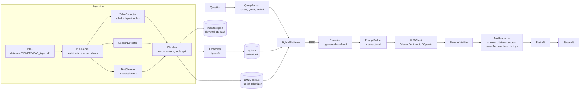

# BIST Report Analyst

**Hybrid-search RAG over KAP disclosures and annual reports of Borsa İstanbul companies.**
Ask in Turkish or English — *"THY'nin 2025 hasılatı ne kadar?"*, *"ASELSAN ile BİM'in son iki yıldaki net kârını karşılaştır"* — and get an answer where every claim carries a page-level citation and every number is checked against the source.

> ⚠️ **Analysis only — never investment advice.** Every answer ends with a disclaimer; the prompt forbids buy/sell/hold recommendations.

---

## The problem

A basic RAG chatbot (fixed-size chunks → dense top-5 → prompt) breaks on financial reports:

| Difficulty | What goes wrong in basic RAG | What this project does |
|---|---|---|
| Long, table-heavy PDFs (100–260 pages) | Fixed-size chunks cut tables in half; rows lose their header | Tables are extracted separately and every chunk repeats caption + header |
| Borderless financial statements | Generic table detectors collapse them into one cell | Custom layout extractor aligns numbers by their right edge |
| Turkish numbers & units | `1.234` parsed as 1.234; `bin TL` vs `milyon TL` confused | `parse_tr_number` + unit-aware numeric verification |
| Many near-identical documents (3 companies × 2 years) | Dense search returns the right topic from the wrong company/year | Metadata filters (ticker, year, period, doc type) applied **inside** both searches |
| Exact tokens: tickers, line items, numbers | Embeddings blur exact terms | BM25 with a Turkish tokenizer + Reciprocal Rank Fusion |
| Comparisons | One company crowds out the other in top-k | Per-(company, year) sub-queries with an equal budget |
| Hallucinated digits | No way to tell | Every number in the answer is traced to a retrieved chunk; unverified ones are highlighted |

## Features

- **Ingestion** (PyMuPDF): page-level text with font info, scanned/garbled page detection (+ optional Tesseract OCR), heuristic header/footer removal, de-hyphenation, font-based section detection.
- **Tables**: PyMuPDF `find_tables()` for ruled tables, a coordinate-based extractor for borderless statements, quality checks that reject garbled extractions → Markdown with caption.
- **Structure-aware chunking**: 350–450 tokens (measured with the embedding model's tokenizer), sentence-level overlap, never across sections; large tables split by rows with repeated header.
- **Hybrid retrieval**: `BAAI/bge-m3` dense vectors in **Qdrant (embedded mode)** + **BM25** (`rank_bm25`, Turkish-aware tokenizer, optional Snowball stemming) → **RRF** (k = 60) → optional **cross-encoder** `BAAI/bge-reranker-v2-m3`. Four switchable modes: `dense`, `bm25`, `hybrid`, `hybrid_rerank`.
- **Query understanding**: rule-based parser for tickers/aliases (`THY`, `Aselsan`, `BİM`, dotless-ı aware), years (`2024 yılı`, `son iki yıl`), periods (`ilk çeyrek`, `Q3`), doc types; optional LLM parser with validated JSON.
- **Generation**: Ollama `qwen2.5:3b-instruct` by default (free, local); Anthropic / OpenAI as optional backends. Versioned prompt template (`prompts/answer_tr.md`).
- **Numeric verification**: every number in the answer is matched against the context allowing format and unit-scale differences (`1,2 milyar TL` ≡ `1.200.000 bin TL`); shown calculations are re-computed.
- **API + UI**: FastAPI (`/ask`, `/documents`, `/companies`, `/ingest`, `/health`) and a Streamlit chat with filters, mode switch, source panel with per-retriever scores and stage timings.
- **Evaluation**: Hit@k, MRR, filter accuracy, numeric faithfulness, unverified-number rate, unanswerable handling, latency — compared across retrieval modes, stemming and table boost.

## Architecture



| Step | Class | File |
|---|---|---|
| PDF → paragraphs/tables | `PDFParser`, `TextCleaner`, `SectionDetector`, `TableExtractor` | `src/kaprag/ingestion/` |
| Metadata from path, company list | `parse_path`, `CompanyRegistry` | `src/kaprag/ingestion/metadata.py` |
| Chunking | `Chunker`, `TokenCounter` | `src/kaprag/chunking/` |
| Indexing | `Embedder`, `DenseIndex`, `BM25Index`, `TurkishTokenizer`, `ChunkStore`, `Indexer` | `src/kaprag/indexing/` |
| Retrieval | `QueryParser`, `HybridRetriever`, `reciprocal_rank_fusion`, `Reranker` | `src/kaprag/retrieval/` |
| Generation | `PromptBuilder`, `LLMClient` (+3 backends), `NumberVerifier` | `src/kaprag/generation/` |
| Orchestration | `RAGPipeline` | `src/kaprag/pipeline.py` |
| Interfaces | Typer CLI, FastAPI, Streamlit | `src/kaprag/cli.py`, `src/kaprag/api/main.py`, `ui/app.py` |

## Screenshots

_Placeholder — add `docs/img/chat.png` (answer with highlighted numbers) and `docs/img/sources.png` (Kaynaklar panel)._

## Setup

Requirements: Linux/macOS, Python 3.12, [`uv`](https://docs.astral.sh/uv/), ~8 GB disk for models.

```bash
uv sync                      # CPU PyTorch by default
# NVIDIA GPU: in pyproject.toml set  torch = { index = "pytorch-cu124" }  and run uv sync again
uv sync --extra api          # optional: Anthropic/OpenAI backends
uv sync --extra ocr          # optional: OCR (+ sudo apt install tesseract-ocr tesseract-ocr-tur)

# Local LLM (free)
curl -fsSL https://ollama.com/install.sh | sh
ollama pull qwen2.5:3b-instruct
```

All settings live in [`config.yaml`](config.yaml) and are validated with Pydantic at startup.

## Data preparation

Download reports manually from [kap.org.tr](https://www.kap.org.tr) or investor-relations pages (no scraper is included on purpose) and place them as:

```
data/raw/<TICKER>/<YEAR>_<doc_type>.pdf          e.g. data/raw/ASELS/2025_faaliyet_raporu.pdf
data/raw/<TICKER>/<YYYY-MM-DD>_ozel_durum.pdf    KAP material-event disclosures
```

`doc_type` ∈ `faaliyet_raporu`, `finansal_rapor`, `ozel_durum`, `other`. CLI flags (`--ticker --year --doc-type --period`) override the path. `data/companies.csv` holds ~30 large BIST companies with Turkish aliases (marked for review).

**Add a new company/report in 3 steps:** (1) add a row to `data/companies.csv` if the ticker is new; (2) drop the PDF into `data/raw/<TICKER>/<YEAR>_<doc_type>.pdf`; (3) `uv run kap ingest` — unchanged documents are skipped.

## Usage

### CLI
```bash
uv run kap inspect THYAO 2025          # parsing stats + sample chunks (sanity check)
uv run kap ingest                      # index all of data/raw (incremental)
uv run kap ingest data/raw/ASELS/2025_faaliyet_raporu.pdf --force
uv run kap list                        # indexed documents
uv run kap remove ASELS 2024 faaliyet_raporu
uv run kap ask "THY'nin 2025 yılı hasılatı ne kadar?"
uv run kap ask "ASELSAN ihracat" --mode bm25 --no-llm   # retrieval only
```

### API + UI
```bash
uv run uvicorn kaprag.api.main:app --port 8000      # http://localhost:8000/docs
uv run streamlit run ui/app.py                      # http://localhost:8501
# or
docker compose up --build                           # Ollama stays on the host
```

```bash
curl -s localhost:8000/ask -H 'content-type: application/json' \
  -d '{"question": "BİM 2025 mağaza sayısı", "retrieval_mode": "hybrid"}' | jq .answer
```

Embedded Qdrant locks its folder: while the API runs, ingest through `POST /ingest` (or the UI's upload tab) instead of the CLI.

### Tests & lint
```bash
uv run pytest -q && uv run ruff check src tests eval ui
```

## Evaluation

<!-- EVAL_RESULTS_START -->
Run: `uv run python eval/run_eval.py` on a laptop CPU (Ryzen 5 5500U, no GPU). 40 questions written from the indexed chunks (34 answerable, 6 unanswerable), all still `reviewed: false`. Full JSON in `eval/results/`.

### Retrieval (34 answerable questions)

| Config | Hit@1 | Hit@3 | Hit@6 | MRR | Comparison side coverage | Retrieval p95 (ms) |
|---|---|---|---|---|---|---|
| dense|stem=off|boost=off | 0.53 | 0.88 | 0.88 | 0.681 | 0.67 | 825 |
| dense|stem=off|boost=on | 0.44 | 0.79 | 0.88 | 0.616 | 0.42 | 758 |
| bm25|stem=off|boost=off | 0.50 | 0.62 | 0.74 | 0.575 | 0.67 | 9 |
| bm25|stem=off|boost=on | 0.50 | 0.62 | 0.68 | 0.560 | 0.58 | 9 |
| bm25|stem=on|boost=off | 0.50 | 0.68 | 0.76 | 0.604 | 0.50 | 9 |
| bm25|stem=on|boost=on | 0.50 | 0.68 | 0.76 | 0.599 | 0.50 | 10 |
| hybrid|stem=off|boost=off | 0.44 | 0.76 | 0.88 | 0.598 | 0.67 | 821 |
| hybrid|stem=off|boost=on | 0.41 | 0.74 | 0.88 | 0.580 | 0.67 | 835 |
| hybrid|stem=on|boost=off | 0.53 | 0.79 | 0.91 | 0.677 | 0.67 | 716 |
| hybrid|stem=on|boost=on | 0.50 | 0.79 | 0.91 | 0.663 | 0.67 | 727 |
| hybrid_rerank|stem=off|boost=off | 0.82 | 0.94 | 0.94 | 0.877 | 0.75 | 44773 |
| hybrid_rerank|stem=off|boost=on | 0.68 | 0.88 | 0.91 | 0.775 | 0.67 | 8453 |
| hybrid_rerank|stem=on|boost=off | 0.82 | 0.94 | 0.94 | 0.877 | 0.75 | 8604 |
| hybrid_rerank|stem=on|boost=on | 0.68 | 0.88 | 0.91 | 0.766 | 0.67 | 2650 |

Reading the table:
- **The cross-encoder reranker is the largest gain**: Hit@1 0.53 → 0.82, MRR 0.68 → 0.88. Its remaining misses are one table lookup (q12, fuel expense) and one comparison (q33).
- **Hybrid alone does not beat dense here.** With Turkish stemming, BM25 improves (Hit@3 0.62 → 0.68) and hybrid slightly overtakes dense (Hit@6 0.91 vs 0.88, MRR 0.677 vs 0.681 ≈ tie). Part of the reason: many questions use the same wording as the reports, which dense handles well too.
- **Table boost hurts in every mode** (rerank Hit@1 0.82 → 0.68): similar-looking subsidiary tables get pushed above the correct page. It is now **off by default** (`retrieval.table_boost_enabled: false`).
- Latency column: the first rerank run shows the real CPU cost (p95 ≈ 45 s for comparison questions with several sub-queries; ~27 s for a single query). Later rerank rows are lower because rerank scores were cached between configurations.

**Filter accuracy** (query parser vs expected tickers/years, 40 questions): tickers **1.00**, years **0.97**, both **0.97**. The one miss (q22) names no year; the expected answer comes from the 2025 report.

### Generation (`qwen2.5:3b-instruct` via Ollama, mode `hybrid_rerank`, table boost **on**, prompt v1.0)

| Numeric faithfulness | Unverified-number rate | Unanswerable handling | False refusals | Answers with citations |
|---|---|---|---|---|
| 0.58 | 0.21 | **1.00** | 0.09 | 0.76 |

- **All 6 unanswerable questions** were answered with "not in the documents"; four of them never reached the LLM because the metadata filter returned zero chunks (e.g. Pegasus, Koç Holding are not indexed).
- **The 3B model is the bottleneck, not retrieval**: Hit@6 is 0.94 but only 58% of the expected numbers appear in the answers. Typical errors: picking a neighbouring number from the right table (AJet passengers), mixing units, and over-using the comparison table format.
- **The verifier catches invented numbers** (q32: a BİM revenue "140,0 Milyar TL" that exists nowhere is flagged) but **not** a real number attached to the wrong line item (q33: "55.614 TL" exists in the context but is not net profit).
- Mean generation time ≈ 78 s per answer (p95 143 s) on CPU.
- False refusals include answers that gave the correct figure and then appended "not in the documents" (q01), a small-model instruction-following issue.
<!-- EVAL_RESULTS_END -->

## Design decisions

| Decision | Chosen | Alternatives | Why |
|---|---|---|---|
| Vector store | Qdrant embedded | Chroma, pgvector, FAISS | Real filtered search, same API scales to a Qdrant server; no Docker needed locally |
| Embeddings | `BAAI/bge-m3` (dense only) | `multilingual-e5-base` | Stronger multilingual retrieval, 8k context; e5 kept as a faster config option (with `query:`/`passage:` prefixes) |
| Fusion | RRF (k = 60) | Weighted score sum | Rank-based, no score normalisation across BM25 and cosine scales |
| Reranker | `bge-reranker-v2-m3` on top-20 | none, LLM reranking | Measured: Hit@1 0.53 → 0.82; costs ~27 s/query on CPU |
| Table extraction | PyMuPDF `find_tables` + custom layout extractor | pdfplumber | pdfplumber was compared on the same pages: character-level garbage on borderless statements, no gain on ruled tables |
| Token counting | Embedding model's tokenizer | word count | Turkish words split into many sub-tokens; word counts under-estimate |
| Query parsing | Rules first, LLM optional | LLM only | Explainable, testable, deterministic, free |
| LLM | Ollama `qwen2.5:3b-instruct` | API models | Free and local by default; backends swap via config only |
| Doc-type words like "bilanço" | soft hint, not a filter | hard filter | Annual reports also contain the statements; a hard filter would hide them |
| Hardware | CPU wheels, device auto-detect | CUDA-only | Developed on a laptop without NVIDIA GPU; runs unchanged on CUDA |

## Limitations

- **Scanned / broken-font PDFs**: ASELSAN's 2025 financial statements use Type-3 fonts with no Unicode mapping (detected as "garbled"), and 40 pages of THY's 2024 report are scans. Both need OCR (`parsing.ocr_enabled`), which needs Tesseract installed.
- **Complex tables**: merged cells, rotated headers and multi-level headers are simplified; some rotated-header tables are rejected by the quality check and fall back to plain text.
- **Consolidated vs standalone** statements and **restated** prior-year figures are not distinguished in metadata.
- **Section titles** are heuristic; decorative large-font text in integrated reports can create noisy section names.
- **CPU latency**: on a laptop CPU the cross-encoder adds seconds per query and a 3B model needs tens of seconds per answer.
- The numeric verifier can confirm that a number *exists* in the context, not that it is attached to the right line item or year.

## Future work

Column-aware table QA (row/column lookups instead of free text), OCR by default with layout models, period-aware metadata (Q1–Q4 from KAP filings), scheduled ingestion of new KAP disclosures (respecting the site's terms), Qdrant server + async workers, LLM-as-judge for answer correctness.

## Disclaimer

This software produces **analysis only and is not investment advice**. Figures come from automated extraction and may be wrong; always check the cited page in the original document.
